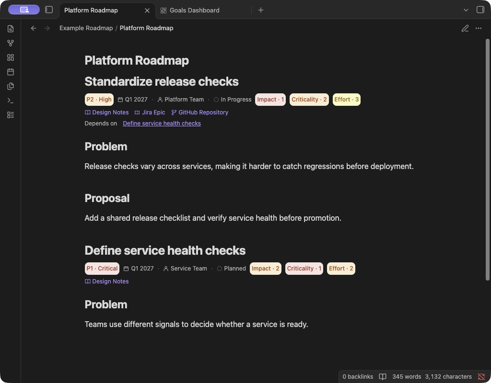
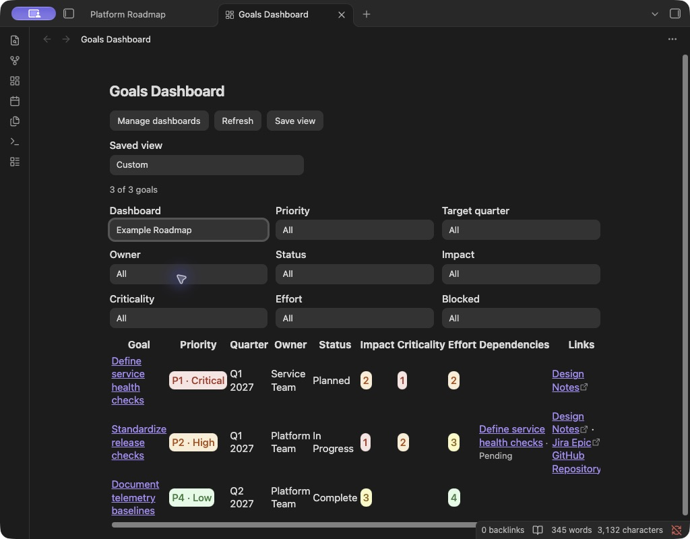

# Goal Metadata for Obsidian

Plan and track goals inside Obsidian. Add a compact strip under any goal heading with priority, target quarter, owner, status, and links. Add optional Impact, Criticality, and Effort ratings, track dependencies, and roll goals up into dashboards.

## Install

Requires **Obsidian Desktop 1.15.1 or later**. The plugin includes its own commands, views, and styling, with no QuickAdd or Dataview dependency.

### From Obsidian’s Community plugins

See the [Goal Metadata listing](https://community.obsidian.md/plugins/goal-metadata) in the Obsidian Community directory. When installation is available, follow these steps in Obsidian:

1. Open **Settings → Community plugins** and select **Turn on community plugins** if prompted.
2. Select **Browse** and search for **Goal Metadata** by **not-really-rob**.
3. Open the plugin, select **Install**, then select **Enable**.

If the plugin does not appear in search or **Install** is unavailable, use the manual installation below.

### Manual installation

1. Under **Assets** on the [latest GitHub release](https://github.com/not-really-rob/goal-metadata/releases/latest), download `main.js`, `manifest.json`, and `styles.css`.
2. Place all three files in your vault’s `.obsidian/plugins/goal-metadata/` folder, creating it if needed. Use the vault’s configured folder in place of `.obsidian` if it differs.
3. Reopen the vault and enable **Goal Metadata** in **Settings → Community plugins**.

The installed path should look like this.

```text
Your vault/
└── .obsidian/
    └── plugins/
        └── goal-metadata/
            ├── main.js
            ├── manifest.json
            └── styles.css
```

## Quick start

1. Open a Markdown note in Editing view.
2. Open the command palette (**⌘P** on macOS, **Ctrl+P** on Windows or Linux) and run **Goal Metadata: Insert New Goal**. If the goal heading already exists, put the cursor in that section and run **Insert Goal Metadata**.
3. Fill in the fields and save. The target defaults to the current calendar quarter and year unless you’ve configured a different default. Choose **TBD** for an unscheduled goal.
4. Switch to Reading view to see the strip. Run **Edit Goal Metadata** to update it later, or use a field-specific command such as **Update Goal Quarter**.



### Extend a goal

- **Add Goal Decision Log** records dated decisions with an optional rationale and follow-up.
- **Add Goal Review Checklist** adds the checklist from the note’s configuration.
- The documentation, work item, and repository fields accept one HTTP or HTTPS URL per line. Their default link text is **Design Notes**, **Jira Epic**, and **GitHub Repository**.

## Dashboards and dependencies

Run **Generate Goals Dashboard** to see all goals with metadata in the vault. Filter by priority, quarter, owner, status, or whether the goal is blocked. Rating filters appear when the vault contains rated goals. Click a goal title to jump to its section, **Refresh** to rescan the vault, or **Save view** to store a dashboard and its filters. Restore that combination from **Saved view**. Saving with the same name updates the stored view.



### Roll up goals by folder

1. Run **Manage Goals Dashboards** and create a dashboard called `2027 Planning`, scoped to the vault folder `2027 Planning`.
2. Put goal notes in that folder or its subfolders. For a separate quarterly dashboard, create one scoped to `2027 Planning/Q1`.
3. Leave the quarterly dashboard’s **Parent dashboard** on **Automatic (from folder)** to roll it up to `2027 Planning`. Choose a specific parent or **No parent** to change that behavior.

For an individual goal, **Set Goal Dashboard** overrides the dashboard. Otherwise, goals inherit the note’s assignment from **Set Note Goals Dashboard**, then the most specific configured folder. **All goals** also includes goals without a dashboard.

### Track blockers

Enter one dependency per line in **Edit Goal Metadata**. Use `[[Planning/Infrastructure#Publish API]]` for another note, or `[[#Publish API]]` for another goal in the same note. The dashboard shows whether each dependency is complete, pending, or unresolved. The **Blocked** filter includes goals explicitly marked Blocked and goals with a pending or unresolved dependency. Configure which statuses satisfy dependencies in **Settings → Goal Metadata**.

## Configurations and note assignments

Open **Settings → Goal Metadata** to change priority names and colors, link text, owner and status defaults, the target quarter, template headings, and review checklist items. Impact, Criticality, and Effort are independently optional, with their own badge colors. Each uses **1 (highest)** through **5 (lowest)** or **None**. Turn on a ranking to reveal its color controls directly below the toggle.

To reuse a setup, enter a name and choose **Save as new configuration**. Then run **Set Note Goal Configuration** in any note to use it for new or edited goals. Choose **Vault default** to inherit your general settings. Save an existing strip with **Edit Goal Metadata** to apply updated labels or switch its configuration. To remove a saved configuration, select it in Settings and confirm **Delete configuration**. The confirmation lists affected notes and shows which fields, colors, labels, and other settings will change. Assigned notes fall back to the vault default and retain their existing goal text and dashboard assignments.

**Set Note Goal Configuration** and **Set Note Goals Dashboard** both offer **Plugin settings only** or **Show name in note properties**. The latter writes the readable name for an explicit assignment. You can re-save an older assignment to replace its ID with the name. These plugin properties are hidden in Reading view.

## Update or uninstall

For Community plugin updates, open **Settings → Community plugins**, select **Check for updates**, and update **Goal Metadata** when a new version is available.

For manual updates, replace `main.js`, `manifest.json`, and `styles.css` with the files from the latest release and reopen the vault. Keep `data.json` to retain configurations, saved views, dashboard definitions, and note assignments.

To uninstall, disable **Goal Metadata** and remove its plugin folder. Goal strips remain in your Markdown notes.

## Contributing

Repository write access is by invitation. Changes to the default branch go through pull requests and maintainer review.

## License

[MIT](LICENSE).
